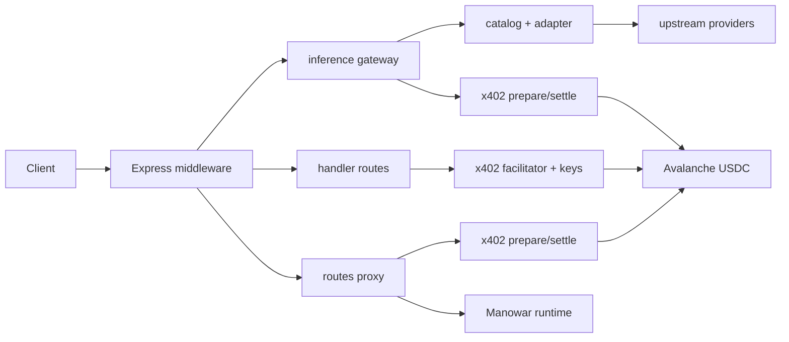

# api

The API gateway for Compose.Market. It serves paid inference, x402 payment
facilitation, agent and workflow proxying, and account management from one
Express process.

Two modules do the heavy lifting and have their own READMEs:

| Module | What it does |
| --- | --- |
| [`inference/`](./inference/README.md) | Multi-provider, multi-modality inference gateway. OpenAI-compatible plus Responses API surfaces, WebSocket realtime, async video. Authoritative metering and x402 settlement on the same HTTP request. |
| [`x402/`](./x402/README.md) | x402 v2 payment facilitator plus Compose Keys, session budgets, payment intents, deferred batch settlement, evidence, and receipts. Settles USDC on Avalanche. |

Everything else is glue or supporting surface.

## What lives here

| Path | Role |
| --- | --- |
| `index.ts` | Process entry. Mounts Express middleware, registers route groups, starts the server or runs a scheduled job. |
| `handler.ts` | API handler. Routes for Compose Keys, sessions, facilitator endpoints, dispenser, registry, avatar generation, batch settlement. |
| `routes.ts` | Agent and workflow proxying. Proxies to the Manowar runtime, wraps each call in x402 prepare/settle, builds agent and workflow receipts. |
| `http/` | CORS, request-id, body parsing, error envelopes. Single-layer CORS policy. |
| `metrics/` | Download, payment, session, and expense sync. Snapshots for the dashboard. |
| `feedback/` | User feedback storage and validation. |
| `user/` | Public EVM/SVM smart-account pair records used to scope cross-network reads. |
| `a2a/` | Agent-to-agent schema types. |
| `backpack/` | Per-agent permissions and Composio account storage. |
| `local/` | Local-network peer registration and Synapse/Filecoin paymaster routes. |
| `dispenser/` | Testnet USDC faucet. |
| `tests/` | Test suite. Run with `npm run tests`. |

## Stack

| Concern | Choice |
| --- | --- |
| Runtime | Node 25 target, Express 5, TypeScript 6 |
| Build | esbuild (single CJS bundle) |
| Payments | `@x402/core`, `@x402/evm`, `viem` |
| Store | Valkey (ioredis, auto-pipelining) |
| Validation | Zod 4 (via x402 schemas), manual parsing in inference |
| Realtime | `ws` (WebSocket realtime vendor) |

## Scripts

```bash
npm run dev          # start the API locally (tsx)
npm run build        # typecheck + esbuild bundle + copy data
npm run tests        # run the test suite
npm run deploy       # fast deploy
npm run deploy:full  # build + full deploy
npm run metrics      # sync metrics + snapshot
npm run init:user-db # initialize public.wallet_pairs once in the empty User DB
```

## Environment

The API reads secrets from env. The names that matter:

| Variable | Purpose |
| --- | --- |
| `FACILITATOR_KEY` | Facilitator signer private key. Drives on-chain USDC settlement. |
| `MERCHANT_WALLET_ADDRESS` | Where settled USDC lands. |
| `TREASURY_SERVER_WALLET_PUBLIC` | Compose Key settlement spender. |
| `COMPOSE_SESSION_SECRET` | HMAC secret for Compose Key JWTs. |
| `DEFAULT_CHAIN` | `avalanche` (default). |
| `USE_MAINNET` | `true` for mainnet, else testnet. |
| `AVALANCHE_FUJI_RPC` | RPC endpoint for Avalanche Fuji (43113). |
| `AVALANCHE_MAINNET_RPC` | RPC endpoint for Avalanche C-Chain (43114). |
| `VALKEY_KEYS_SERVICE_URI` | Valkey connection URI for keys, budgets, intents, evidence, receipts. |
| `USER_DATABASE_URL` | Neon connection URL for the public smart-account pair registry. |
| `RUNTIME_URL` | Manowar runtime base URL for agent/workflow proxying. |

## Architecture



The inference gateway and the routes proxy both wrap each call in the same
x402 prepare/settle harness. The handler exposes the facilitator and key
management endpoints directly. Settlement lands on Avalanche.

## Related

- [inference/](./inference/README.md)
- [x402/](./x402/README.md)
