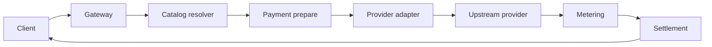

# inference

Multi-provider inference gateway with x402 payment on the same HTTP request.

Most inference gateways answer one question: which provider should handle this
model call. Compose answers that, then keeps the payment state attached to the
request. The API can tell you which model answered, what was authorized, what
the provider reported, what was settled, and which receipt belongs to the call.

That combination is not available in other inference surfaces. The comparison
is factual:

| Product | Good at | Different from Compose |
| --- | --- | --- |
| OpenAI, Gemini, Anthropic APIs | Direct provider access, first-party features | You manage provider accounts, catalog differences, and per-provider metering yourself. |
| OpenRouter | OpenAI-compatible routing across many models | Payment is account-credit-based, not x402 per paid HTTP request. 5.5% fee. |
| LiteLLM | Self-hosted proxy, provider normalization, budget controls | It is a proxy layer. No x402, no receipts, no hosted payment. |
| AI SDK | App-side TypeScript abstractions for model calls | It is a client library. Compose is a paid HTTP gateway the AI SDK can call. |
| Cloudflare, Together, Fireworks, Hugging Face | Provider or router-specific inference APIs | They are upstreams or peers. Compose adds session budget, x402, and receipts around calls. |

Use Compose when billing is part of the request lifecycle: budgeted keys, raw
x402, receipts, and catalog-backed metering. If you only need a generic LLM
router, use the router that fits that job.

## Two surfaces

| Surface | Base path | Who it is for |
| --- | --- | --- |
| Native | `/v1` | Clients that want x402 negotiation, Compose receipts, response retrieval, and full model metadata. |
| External | `/external/v1` | IDEs and apps that already speak the OpenAI API shape and only support bearer auth. |

Both surfaces use the same catalog and adapters. The difference is the contract
around the call: native routes can expose Compose receipts and x402 details,
while external routes keep response bodies compatible with OpenAI-style clients.

## Catalog

The generated catalog is the source of truth for provider rows. It is
deduplicated by provider priority.

```text
504 curated models
11 providers
6 modalities (text, image, audio, video, embedding, realtime)
20 task types
30 model families
```

| Provider | Models | Role |
| --- | --- | --- |
| `gemini` | 43 | Google AI direct wire |
| `azure` | 29 | Azure Microsoft Foundry |
| `fireworks` | 14 | Fireworks AI |
| `alibaba` | 212 | Alibaba Cloud (Qwen, Wan, CosyVoice) |
| `openai` | 22 | OpenAI direct + Responses wire |
| `cloudflare` | 62 | Cloudflare Workers AI |
| `deepgram` | 8 | Deepgram TTS + STT + realtime |
| `elevenlabs` | 11 | ElevenLabs TTS + music + realtime |
| `cartesia` | 13 | Cartesia TTS |
| `roboflow` | 84 | Roboflow vision, embeddings, OCR |
| `asicloud` | 6 | ASI Cloud |

The model string is the contract. Compose does not inspect the prompt to guess
a provider, and it does not silently fall back to a duplicate provider row.
Duplicate upstream IDs are explicit: the priority winner keeps the bare ID, the
other provider rows get readable public aliases.

| Public model ID | Provider selected | Provider wire model |
| --- | --- | --- |
| `gpt-5.5` | `azure` | `gpt-5.5` |
| `openai/gpt-5.5` | `openai` | `gpt-5.5` |

## Native routes

| Method | Path | Description |
| --- | --- | --- |
| `GET` | `/v1/models` | Compiled catalog (504 models). |
| `GET` | `/v1/models/all` | Extended catalog, when present. |
| `POST` | `/v1/models/search` | Filter by provider, modality, operation, streaming, context, price. |
| `GET` | `/v1/families` | Model family catalog. |
| `GET` | `/v1/modalities` | Modality catalog derived from model metadata. |
| `GET` | `/v1/models/:model` | Single model card. |
| `GET` | `/v1/models/:model/params` | Per-model parameter schema. |
| `POST` | `/v1/chat/completions` | OpenAI-shaped chat completions. |
| `POST` | `/v1/responses` | OpenAI-shaped Responses API. |
| `POST` | `/v1/embeddings` | Embeddings. |
| `POST` | `/v1/images/generations` | Image generation. |
| `POST` | `/v1/images/edits` | Image editing. |
| `POST` | `/v1/audio/speech` | Text to speech. |
| `POST` | `/v1/audio/transcriptions` | Speech to text. |
| `POST` | `/v1/videos/generations` | Video generation submission. |
| `GET` | `/v1/videos/:id` | Video job status. |
| `GET` | `/v1/videos/:id/stream` | Video job status over SSE. |
| `GET` | `/v1/responses/:id` | Retrieve a stored response. |
| `GET` | `/v1/responses/:id/input_items` | Input items for a stored response. |
| `POST` | `/v1/responses/:id/input_items` | Append to a live realtime session. |
| `POST` | `/v1/responses/:id/cancel` | Cancel a response or close a realtime session. |

## External routes

| Method | Path | Description |
| --- | --- | --- |
| `GET` | `/external/v1/models` | OpenAI-shaped model list. |
| `POST` | `/external/v1/chat/completions` | Chat completions with Compose Key auth. |
| `POST` | `/external/v1/responses` | Responses-style calls with Compose Key auth. |
| `POST` | `/external/v1/embeddings` | Embeddings with Compose Key auth. |
| `POST` | `/external/v1/images/generations` | Image generation with Compose Key auth. |
| `POST` | `/external/v1/audio/speech` | Speech generation with Compose Key auth. |
| `POST` | `/external/v1/audio/transcriptions` | Transcription with Compose Key auth. |
| `POST` | `/external/v1/videos/generations` | Video generation with Compose Key auth. |
| `GET` | `/.well-known/opencode` | Remote OpenCode config. |

External routes use `Authorization: Bearer compose-<jwt>`. They return
OpenAI-shaped JSON and SSE, and keep Compose receipts out of the response body.

## How a request runs



That flow is intentionally plain: resolve the catalog row, authorize the spend,
call the adapter, meter the result, settle the payment.

The order matters. Compose does not guess the bill from the prompt. It prices
the request from provider output: token usage for text and embeddings, media
evidence for image/audio/video, and the model pricing stored in the generated
catalog.

## Streaming

Chat and responses streams use OpenAI-shaped SSE chunks. Native routes can also
emit Compose named events:

| Event | Meaning |
| --- | --- |
| `receipt` | Payment settled. Final amount, network, line items, optional transaction hash. |
| `compose.error` | Structured stream error before the stream closes. |
| `compose.video.status` | Video job status update. |

External streams remove these events and keep the stream OpenAI-shaped.

```bash
curl -N https://api.compose.market/v1/chat/completions \
  -H "Authorization: Bearer $COMPOSE_MARKET_API_KEY" \
  -H "Content-Type: application/json" \
  -H "x-chain-id: 43113" \
  -d '{
    "model": "gpt-5.5",
    "stream": true,
    "stream_options": { "include_usage": true },
    "messages": [
      { "role": "user", "content": "Give me one line." }
    ]
  }'
```

## Realtime

WebSocket realtime supports 7 service routes across Deepgram, Google, Alibaba,
OpenAI, and ElevenLabs:

| Route | Provider | Operation |
| --- | --- | --- |
| `/flux` | Deepgram | Turn detection, STT |
| `/lyria` | Google | Music generation |
| `/qwen-omni` | Alibaba | Omni realtime |
| `/realtime-2` | OpenAI | Realtime |
| `/realtime-translate` | Alibaba | Live translation |
| `/scribe` | ElevenLabs | STT |
| `/whisper` | OpenAI | Whisper STT |

Realtime sessions are opened via `POST /v1/responses`, appended via
`POST /v1/responses/:id/input_items`, and closed via
`POST /v1/responses/:id/cancel`. Settlement is incremental: usage and media
deltas are priced and settled during the stream.

## Metering

All settlement amounts are USDC atomic units. USDC has 6 decimals:

```text
1 USDC = 1000000
```

The final amount is:

```text
provider amount + platform fee
```

The API applies a 1% platform fee on top of the raw provider amount. That is
5.5x lower than OpenRouter's 5.5%, and it is factual.

Compose separates authorization from settlement:

| Phase | What happens |
| --- | --- |
| Authorization | The request reserves an exact amount or an `upto` cap. |
| Execution | The selected adapter runs the provider call. |
| Settlement | The API extracts authoritative usage/media evidence, prices it, and settles the final amount. |
| Abort | If execution fails before settlement, the prepared payment is released. |

Usage-priced text, image, and video calls use a budget cap and settle after
output. The server determines the actual charge from real usage, not the
client's upfront quote.

```json
{
  "subject": "azure:gpt-5.5",
  "lineItems": [
    {
      "key": "input",
      "unit": "usd_per_1m_input_tokens",
      "quantity": 1000,
      "unitPriceUsd": 1.25,
      "amountWei": "1250"
    }
  ],
  "providerAmountWei": "1250",
  "platformFeeWei": "13",
  "finalAmountWei": "1263"
}
```

## Code structure

| File | Role |
| --- | --- |
| `gateway.ts` | HTTP routes, payment lifecycle, SSE framing, response records. |
| `core.ts` | Canonical types, request normalization, response formatting. |
| `engine.ts` | Thin orchestrator wrapping the adapter in retry policy. |
| `policy.ts` | Jittered backoff retry. Retries 5xx, 429, timeouts. |
| `runtime.ts` | Barrel re-export of the canonical inference surface. |
| `external.ts` | External OpenAI-compatible surface with Compose Key auth. |
| `params-handler.ts` | Universal parameter aggregation with lowest-cost defaults. |
| `telemetry.ts` | Pricing normalization, usage extraction, billing metric derivation. |
| `types.ts` | OpenAI type definitions, ModelCard schema, provider registry. |
| `catalog/registry.ts` | Model registry. Loads `data/models.json`, builds indexes, search. |
| `catalog/adapter.ts` | Provider dispatcher. Routes by modality + provider to family or vendor modules. |
| `catalog/modalities/` | 6 modality classifiers: text, image, audio, video, embeddings, realtime. |
| `catalog/families/` | 17 provider-native wire protocol modules (OpenAI, Anthropic, Google, etc.). |
| `catalog/vendors/` | 9 backend wiring modules (Azure, Vertex, Fireworks, Cloudflare, etc.). |
| `catalog/shared/` | Coercion, HTTP, media, messages, usage, JSON Schema lowering. |

## Trade-offs, plainly

Compose does not hide every provider difference. Some models support tools,
some do not. Some stream usage, some only return final usage. Some support
image input, some only text. The catalog exposes those differences so clients
can choose before sending work.

That is less tidy than pretending every model is identical, but it is much
easier to debug.

## Related

- [x402/](../x402/README.md) — payment facilitator, Compose Keys, session budgets.
- [inference docs](https://docs.compose.market/inference/introduction)
- [metering docs](https://docs.compose.market/inference/metering)
