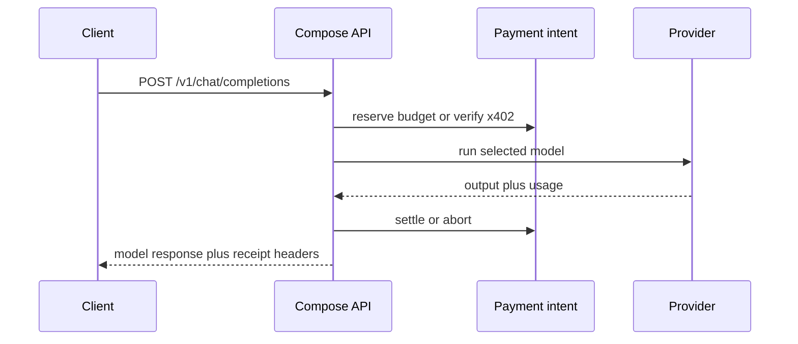
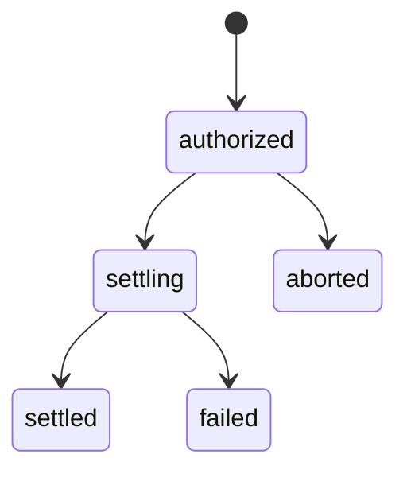

# x402

x402 v2 payment facilitator with Compose Keys, session budgets, deferred batch
settlement, evidence, and receipts. Settles USDC on Avalanche.

The x402 spec defines a facilitator that verifies client payment signatures and
settles them on-chain. The reference `@x402/evm` facilitator does verify and
settle for `exact`, `upto`, and `batch-settlement` schemes. That is the floor.

This module is a complete payment platform built on top of the spec. The
differences are factual:

| Capability | Reference x402 facilitator | This module |
| --- | --- | --- |
| `exact` / `upto` / `batch-settlement` schemes | Yes | Yes |
| Compose Keys (budgeted bearer JWTs) | No | Yes |
| Session budgets (off-chain ledger, deferred on-chain settlement) | No | Yes |
| Payment intents (authorize / settle / abort) | No | Yes |
| Authoritative usage metering | No | Yes |
| Deferred batch settlement accumulator | No | Yes |
| Charge evidence (per-run audit trail) | No | Yes |
| Receipts (durable, cumulative, with line items and bills) | No | Yes |
| Multi-scheme on same facilitator | Yes | Yes |
| Receipts attached to inference responses | No | Yes |

The x402 spec has 0 fees built in. Compose charges a 1% platform fee on
settled inference. That is 5.5x lower than OpenRouter's 5.5%, and it is factual.

## Two payment paths

One harness, two paradigms. Both flow through the same `prepareInferencePayment`
/ `settlePreparedInferencePayment` entry points.

| Path | Auth | Flow |
| --- | --- | --- |
| Raw x402 | `PAYMENT-SIGNATURE` header | Client gets 402, signs the requirement, retries. Facilitator verifies and settles on-chain. |
| Compose Key | `Authorization: Bearer compose-<jwt>` | Client sends a budgeted bearer token. Server locks budget, settles after execution. No wallet signature per call. |

Use raw x402 for wallet-native clients. Use Compose Keys for IDEs, apps, and
first-party sessions that expect bearer auth.

## Chains

| Chain | Chain ID | USDC address | Testnet |
| --- | --- | --- | --- |
| Avalanche Fuji | 43113 | `0x5425890298aed601595a70AB815c96711a31Bc65` | Yes |
| Avalanche C-Chain | 43114 | `0xB97EF9Ef8734C71904D8002F8b6Bc66Dd9c48a6E` | No |

Active chain is selected by `DEFAULT_CHAIN` + `USE_MAINNET` env vars.

## Facilitator endpoints

| Method | Path | Purpose |
| --- | --- | --- |
| `GET` | `/api/x402/facilitator/supported` | Supported x402 versions, networks, schemes, extensions. |
| `GET` | `/api/x402/facilitator/chains` | Configured chains, USDC addresses, explorers, default chain. |
| `POST` | `/api/x402/facilitator/verify` | Verify a payment payload against requirements. |
| `POST` | `/api/x402/facilitator/settle` | Settle a payment on-chain. |

The facilitator registers two Compose extensions advertised in `/supported`:
`compose-metering-v1` (authoritative usage, meter endpoint) and
`compose-payment-intent-v1` (authorize / settle / abort endpoints).

## Payment intent endpoints

| Method | Path | Purpose |
| --- | --- | --- |
| `POST` | `/api/payments/prepare` | Authorize an exact amount, a metered quote, or a budget cap. |
| `POST` | `/api/payments/settle` | Settle an intent with a final amount or metered usage. |
| `POST` | `/api/payments/abort` | Release a prepared intent when work fails before settlement. |
| `POST` | `/api/payments/meter/model` | Price model usage using catalog pricing. |



## Intent lifecycle



Intents are idempotent. Settled intents replay without double-charging. Aborted
intents replay without double-releasing. Authorization deduplicates by
`(keyId, idempotencyKey)`.

## Schemes

| Scheme | Meaning |
| --- | --- |
| [`exact`](https://docs.x402.org/schemes/exact) | The amount is known before execution. The client authorizes that amount. |
| [`upto`](https://docs.x402.org/schemes/upto) | The client authorizes a maximum. Compose settles the measured amount, capped by that maximum. Uses Permit2. |
| [`batch-settlement`](https://docs.x402.org/schemes/batch-settlement) | Off-chain vouchers accumulated per request, redeemed on-chain in batches. Used for realtime and high-throughput. |

Usage-priced inference uses `upto` because the final token count or media
evidence is known only after the provider responds. Realtime uses
`batch-settlement` because charges accumulate during a live session.

## Session budgets

A session budget is an off-chain ledger in Valkey that enables instant
authorization with deferred on-chain settlement.

```text
user creates session → USDC.approve to treasury
                     → budget tracked in Valkey
                     → each request locks budget atomically (HINCRBY)
                     → batch worker settles locked amounts on-chain
```

| Operation | What it does |
| --- | --- |
| `lockBudget` | Atomically reserves budget for a request. Double-check rollback on race. |
| `markSettled` | Moves locked amount to used. |
| `unlockBudget` | Releases a lock on failed settlement. |
| `getSpendableSessionBudgetWei` | `min(off-chain remaining, on-chain allowance remaining)`. Both must be sufficient. |

The spendable cap is the minimum of the off-chain budget remaining and the
on-chain USDC allowance remaining. Both constrain. The server does not let a
client spend off-chain budget that has no on-chain backing.

## Deferred settlement

Session-path charges are queued off-chain (status `queued`, no txHash) at
inference time. A batch worker drains them via `runBatchSettlementCycle`:

| Step | What happens |
| --- | --- |
| Queue | Each settled session charge locks budget, creates a pending intent. |
| Kick | Terminal settlement triggers a deduped, retried batch kick. |
| Accumulate | The batch worker groups pending intents by `user:chain`. |
| Settle | One `USDC.transferFrom` per group settles all pending intents. |
| Reconcile | Evidence and receipts are marked settled with the tx hash. |

```bash
# Trigger batch settlement manually
curl -X POST https://api.compose.market/api/settlement/batch
```

The batch worker can also be triggered on a schedule.

## Headers

| Header | Direction | Meaning |
| --- | --- | --- |
| `PAYMENT-REQUIRED` | Response | Encoded x402 payment requirement for raw x402 clients. |
| `PAYMENT-SIGNATURE` | Request | Signed x402 payment payload on the retry request. |
| `PAYMENT-RESPONSE` | Response | Encoded x402 settlement response. |
| `Authorization` | Request | `Bearer compose-<jwt>` for Compose Key clients. |
| `X-Receipt` | Response | Base64 JSON receipt for native routes. |
| `X-Transaction-Hash` | Response | Settlement transaction hash when available. |
| `x-payment-intent-id` | Response | Prepared payment intent ID. |
| `x-key-budget-remaining` | Response | Remaining key budget after settlement. |
| `x-session-budget-remaining` | Response | Remaining session budget. |
| `x-session-status` | Response | `budget-low`, `budget-depleted`, `expiring-soon`. |

## Compose Keys

Compose Keys are JWT tokens with a `compose-` prefix. Two purposes:

| Purpose | Use case |
| --- | --- |
| `session` | First-party app sessions. Budget tracked in the session ledger. Deferred settlement. |
| `api` | External API clients (Cursor, OpenCode, custom scripts). Budget tracked per-key. Synchronous settlement. |

```bash
# Create a Compose Key
curl -X POST https://api.compose.market/api/keys \
  -H "x-session-user-address: 0x..." \
  -H "Content-Type: application/json" \
  -d '{
    "purpose": "api",
    "budgetLimit": 10000000,
    "expiresAt": 1759200000000,
    "chainId": 43113,
    "name": "my-api-key"
  }'
```

Key validation is 5-step: JWT signature verify, revocation check, record
lookup, server-side expiry, budget check. Keys are stored in Valkey with TTL
matching their expiry.

## Evidence and receipts

Every chargeable operation records evidence in Valkey (24h TTL), indexed by
execution run, parent run, channel, intent, and session.

| Record | TTL | Purpose |
| --- | --- | --- |
| Charge evidence | 24h | Per-charge audit trail. Enables receipt reconstruction and settlement reconciliation. |
| Receipt | 180 days | Durable charge record with line items, bills, and cumulative aggregates. |

Receipts are key-gated. Listing requires a valid Compose Key, and the returned
`userAddress` is the key's subject, not a query parameter.

## Code structure

| File | Role |
| --- | --- |
| `index.ts` | Main entry. `prepareInferencePayment`, `settlePreparedInferencePayment`, `runBatchSettlementCycle`, `kickBatchSettlement`. |
| `facilitator.ts` | x402 facilitator. Verify, settle, supported, chains. Registers `exact`, `upto`, `batch-settlement` schemes. |
| `envelope.ts` | Per-run payment envelope (maxAmount / used / remaining) in Valkey. 15-min TTL. |
| `channels.ts` | Native on-chain batch-settlement voucher channels. `BatchSettlementChannelManager`. |
| `intents.ts` | Payment intents: authorize, settle, abort. Idempotent, Valkey-locked. |
| `settlement.ts` | On-chain `USDC.transferFrom` for Compose Key settlement. |
| `batch.ts` | Batch-settlement voucher channel storage and commit/queue helpers. |
| `metering.ts` | Authoritative usage metering. Line-item quoting, 1% platform fee, billing model resolution. |
| `session-budget.ts` | Session budget ledger. Lock, unlock, markSettled. Atomic HINCRBY. |
| `session-allowance.ts` | On-chain USDC allowance and balance reads. Funding readiness checks. |
| `evidence.ts` | Charge evidence recording and listing. Indexed by run, parent, channel, intent, session. |
| `receipts.ts` | Receipts, bills, line items. Store, finalize, list. JSON and header serialization. |
| `wallets.ts` | Wallet address env config and chain/asset resolution. |
| `accumulator/` | Batch settlement worker. Groups pending intents, one `transferFrom` per user:chain. |
| `keys/` | Compose Keys: JWT sign/verify, Valkey storage, middleware, SSE session events, expiry worker. |
| `configs/chains.ts` | Chain config, USDC addresses, RPC env vars, viem chain map, active chain selection. |

## Related

- [inference/](../inference/README.md) — inference gateway that uses this payment layer.
- [x402 introduction](https://docs.compose.market/x402/introduction)
- [facilitator docs](https://docs.compose.market/x402/facilitator)
- [x402 spec](https://docs.x402.org)
