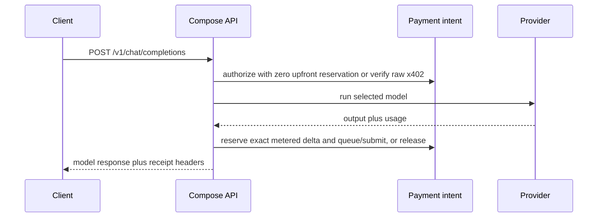
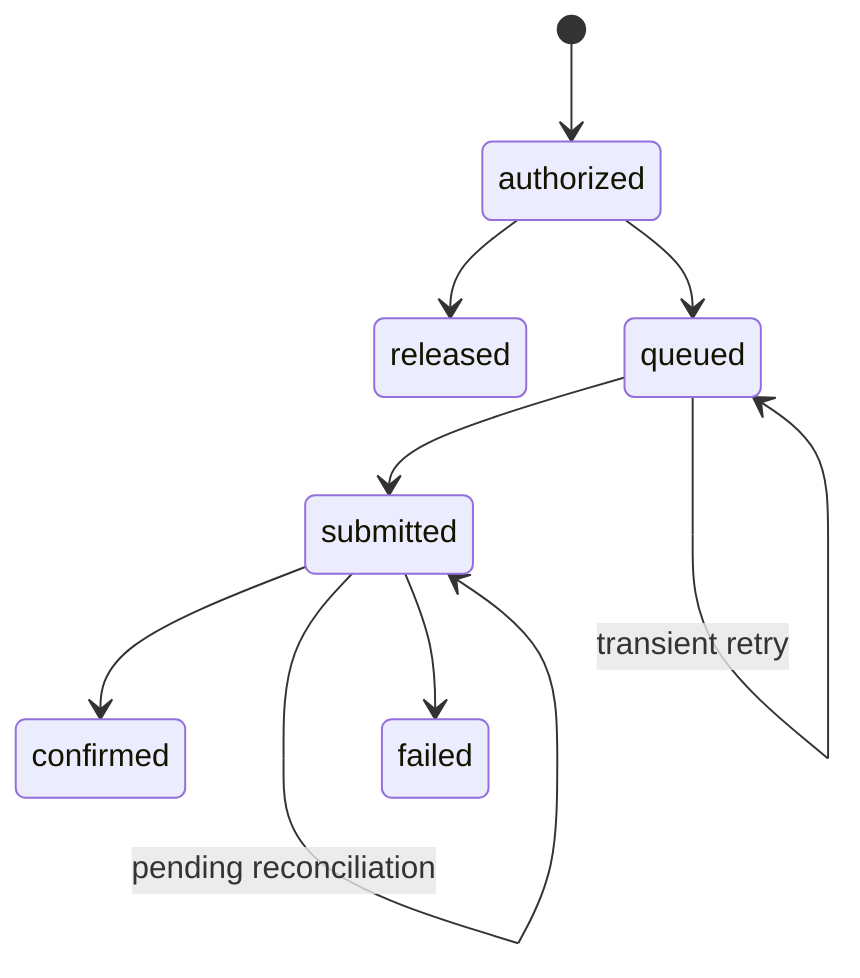

# x402

x402 v2 payment facilitator with Compose Keys, canonical payment intents,
continuous checkpoint charging, deferred settlement, evidence, and receipts.
Every payment is routed by its CAIP-2 `NetworkId` and registry-defined USDC
asset.

The x402 spec defines a facilitator that verifies client payment signatures and
settles them on-chain. The reference `@x402/evm` facilitator does verify and
settle for `exact`, `upto`, and `batch-settlement` schemes. That is the floor.

This module is a complete payment platform built on top of the spec. The
differences are factual:

| Capability | Reference x402 facilitator | This module |
| --- | --- | --- |
| `exact` / `upto` / `batch-settlement` schemes | Yes | Yes |
| Compose Keys (budgeted bearer JWTs) | No | Yes |
| Per-key durable budgets (off-chain ledger, confirmed on-chain settlement) | No | Yes |
| Payment intents (authorize / settle / abort) | No | Yes |
| Authoritative usage metering | No | Yes |
| Deferred batch settlement accumulator | No | Yes |
| Charge evidence (per-run audit trail) | No | Yes |
| Receipts (durable, cumulative, with line items and bills) | No | Yes |
| Multi-scheme on same facilitator | Yes | Yes |
| Receipts attached to inference responses | No | Yes |

The x402 spec has 0 fees built in. Compose charges a 1% platform fee on
settled inference. That is 5.5x lower than OpenRouter's 5.5%, and it is factual.

## Two payment paths

One harness, two paradigms. Both flow through the same `prepareInferencePayment`
/ `settlePreparedInferencePayment` entry points.

| Path | Auth | Flow |
| --- | --- | --- |
| Raw x402 | `PAYMENT-SIGNATURE` header | Client gets 402, signs the requirement, retries. Facilitator verifies and settles on-chain. |
| Compose Key | `Authorization: Bearer compose-<jwt>` | Client sends a budgeted bearer token. Authoritative usage checkpoints reserve exact deltas and enter the canonical settlement lifecycle. No wallet signature per call. |

Use raw x402 for wallet-native clients. Use Compose Keys for IDEs, apps, and
first-party sessions that expect bearer auth.

## Networks

`configs/chains.ts` is the only network and asset registry. Public requests use
`x-network-id`; payment requirements, keys, intents, receipts, evidence, and
workers persist the same `NetworkId`. No numeric-chain compatibility fields or
asset fallbacks are supported.

## Facilitator endpoints

| Method | Path | Purpose |
| --- | --- | --- |
| `GET` | `/api/x402/facilitator/supported` | Supported x402 versions, networks, schemes, extensions. |
| `GET` | `/api/x402/facilitator/chains` | Configured chains, USDC addresses, explorers, default chain. |
| `POST` | `/api/x402/facilitator/verify` | Verify a payment payload against requirements. |
| `POST` | `/api/x402/facilitator/settle` | Settle a payment on-chain. |

The facilitator registers two Compose extensions advertised in `/supported`:
`compose-metering-v1` (authoritative usage, meter endpoint) and
`compose-payment-intent-v1` (authorize / settle / abort endpoints).

## Payment intent endpoints

| Method | Path | Purpose |
| --- | --- | --- |
| `POST` | `/api/payments/prepare` | Authorize an exact amount, a metered quote, or a budget cap. |
| `POST` | `/api/payments/settle` | Settle an intent with a final amount or metered usage. |
| `POST` | `/api/payments/abort` | Release a prepared intent when work fails before settlement. |
| `POST` | `/api/payments/meter/model` | Price model usage using catalog pricing. |



## Intent lifecycle



Intents are idempotent. Confirmed intents replay without double-charging and
released intents replay without double-releasing. Authorization deduplicates
by `(network, keyId, rootRunId, executionRunId, sequence)`. Only `confirmed`
commits reserved budget to used budget and projects settled evidence/receipts.

## Schemes

| Scheme | Meaning |
| --- | --- |
| [`exact`](https://docs.x402.org/schemes/exact) | The amount is known before execution. The client authorizes that amount. |
| [`upto`](https://docs.x402.org/schemes/upto) | Single-use authorization for an unknown final amount capped by the signed maximum. Uses Permit2. |
| [`batch-settlement`](https://docs.x402.org/schemes/batch-settlement) | Reusable cumulative channel vouchers for continuous raw-x402 checkpoints. |

Raw `exact` and `upto` payloads are request-scoped and are never inherited by a
later call. Continuous raw-x402 streams use `batch-settlement`. Compose Key
streams use canonical per-checkpoint intents rather than reusing a raw payment
payload.

## Session budgets

A Session uses the same per-key durable ledger and canonical intent records as
an API-purpose Compose Key. `purpose` is credential/UI metadata; it does not
create another budget authority.

```text
user creates session → funding readiness checked once
                     → key:<keyId> stores limit / used / reserved
                     → authorization reserves zero
                     → each usage checkpoint reserves its exact positive delta
                     → worker submits and confirms that checkpoint on-chain
```

Session discovery reads only durable key identity, expiry, revocation, and
`budgetLimit`, `budgetUsed`, and `budgetReserved`. Live RPC balance/allowance
evidence is checked at creation and payment execution boundaries; an RPC
failure never changes whether a Session exists and is never translated into
zero allowance.

## Deferred settlement

Session checkpoints are queued off-chain (status `queued`, no `txHash`) at
inference time. The settlement worker drains them via
`runBatchSettlementCycle`:

| Step | What happens |
| --- | --- |
| Queue | Each checkpoint reserves its exact metered delta and creates one payable intent. |
| Kick | Terminal settlement triggers a deduped, retried batch kick. |
| Submit | A claimed intent is prepared durably and broadcast once. |
| Reconcile | A submitted hash is polled; it is never rebroadcast merely because confirmation timed out. |
| Confirm | A successful receipt commits budget and projects settled evidence/receipts. |

```bash
# Trigger batch settlement manually
curl -X POST https://api.compose.market/api/settlement/batch
```

The batch worker can also be triggered on a schedule.

## Headers

| Header | Direction | Meaning |
| --- | --- | --- |
| `PAYMENT-REQUIRED` | Response | Encoded x402 payment requirement for raw x402 clients. |
| `PAYMENT-SIGNATURE` | Request | Signed x402 payment payload on the retry request. |
| `PAYMENT-RESPONSE` | Response | Encoded x402 settlement response. |
| `Authorization` | Request | `Bearer compose-<jwt>` for Compose Key clients. |
| `X-Receipt` | Response | Base64 JSON receipt for native routes. |
| `X-Transaction-Hash` | Response | Settlement transaction hash when available. |
| `x-payment-intent-id` | Response | Prepared payment intent ID. |
| `x-key-budget-remaining` | Response | Remaining key budget after settlement. |
| `x-session-budget-remaining` | Response | Remaining session budget. |
| `x-session-status` | Response | `budget-low`, `budget-depleted`, `expiring-soon`. |

## Compose Keys

Compose Keys are JWT tokens with a `compose-` prefix. Two purposes:

| Purpose | Use case |
| --- | --- |
| `session` | First-party app sessions. Exact checkpoint reservations; deferred worker submission. |
| `api` | External API clients (Cursor, OpenCode, custom scripts). Exact checkpoint reservations; direct submission. |

```bash
# Create a Compose Key
curl -X POST https://api.compose.market/api/keys \
  -H "x-session-user-address: 0x..." \
  -H "Content-Type: application/json" \
  -d '{
    "purpose": "api",
    "budgetLimit": 10000000,
    "expiresAt": 1759200000000,
    "network": "eip155:5042002",
    "name": "my-api-key"
  }'
```

Key validation is 5-step: JWT signature verify, revocation check, record
lookup, server-side expiry, budget check. Keys are stored in Valkey with TTL
matching their expiry.

## Evidence and receipts

Every chargeable operation records evidence in Valkey (24h TTL), indexed by
execution run, parent run, channel, intent, and session.

| Record | TTL | Purpose |
| --- | --- | --- |
| Charge evidence | 24h | Per-charge audit trail. Enables receipt reconstruction and settlement reconciliation. |
| Receipt | 180 days | Durable charge record with line items, bills, and cumulative aggregates. |

Receipts are key-gated. Listing requires a valid Compose Key, and the returned
`userAddress` is the key's subject, not a query parameter.

## Code structure

| File | Role |
| --- | --- |
| `index.ts` | Main entry. `prepareInferencePayment`, `settlePreparedInferencePayment`, `runBatchSettlementCycle`, `kickBatchSettlement`. |
| `facilitator.ts` | x402 facilitator. Verify, settle, supported, chains. Registers `exact`, `upto`, `batch-settlement` schemes. |
| `envelope.ts` | Durable raw batch-settlement envelope and checkpoint authority. |
| `channels.ts` | Native on-chain batch-settlement voucher channels. `BatchSettlementChannelManager`. |
| `intents.ts` | Canonical Compose payment lifecycle: authorize, reserve/queue, submit, reconcile, confirm/release/fail. |
| `settlement.ts` | On-chain `USDC.transferFrom` for Compose Key settlement. |
| `batch.ts` | Batch-settlement voucher channel storage and commit/queue helpers. |
| `metering.ts` | Authoritative usage metering. Line-item quoting, 1% platform fee, billing model resolution. |
| `session-allowance.ts` | On-chain USDC allowance and balance reads. Funding readiness checks. |
| `evidence.ts` | Charge evidence recording and listing. Indexed by run, parent, channel, intent, session. |
| `receipts.ts` | Receipts, bills, line items. Store, finalize, list. JSON and header serialization. |
| `wallets.ts` | Wallet address env config and chain/asset resolution. |
| `accumulator/` | Canonical queued/submitted intent worker with retry and receipt reconciliation. |
| `keys/` | Compose Keys: JWT sign/verify, Valkey storage, middleware, SSE session events, expiry worker. |
| `configs/chains.ts` | Authoritative CAIP-2 network, USDC asset, RPC env, and viem-chain registry. |

## Related

- [inference/](../inference/README.md) — inference gateway that uses this payment layer.
- [x402 introduction](https://docs.compose.market/x402/introduction)
- [facilitator docs](https://docs.compose.market/x402/facilitator)
- [x402 spec](https://docs.x402.org)
